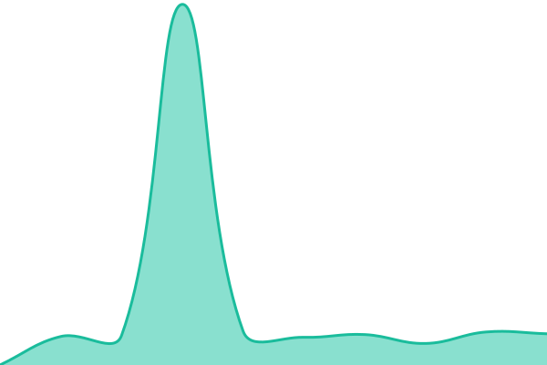

# [📈 Live Status](https://status.emaaad.com): <!--live status--> **🟩 All systems operational**

This repository contains the open-source uptime monitor and status page for [Emad](https://emaaad.com), powered by [Upptime](https://github.com/upptime/upptime).

With [Upptime](https://upptime.js.org), you can get your own unlimited and free uptime monitor and status page, powered entirely by a GitHub repository. We use [Issues](https://github.com/emadbaqeri/effective-disco-status/issues) as incident reports, [Actions](https://github.com/emadbaqeri/effective-disco-status/actions) as uptime monitors, and [Pages](https://status.emaaad.com) for the status page.

<!--start: status pages-->
<!-- This summary is generated by Upptime (https://github.com/upptime/upptime) -->
<!-- Do not edit this manually, your changes will be overwritten -->
<!-- prettier-ignore -->
| URL | Status | History | Response Time | Uptime |
| --- | ------ | ------- | ------------- | ------ |
|  [Web app](https://disco.emaaad.com) | 🟩 Up | [web-app.yml](https://github.com/emadbaqeri/effective-disco-status/commits/HEAD/history/web-app.yml) | 

 3433ms
     
 | 

<a href="https://status.emaaad.com/history/web-app">95.56%</a>
    

|  [API](https://disco-api.emaaad.com/health) | 🟩 Up | [api.yml](https://github.com/emadbaqeri/effective-disco-status/commits/HEAD/history/api.yml) | 

 3234ms
     
 | 

<a href="https://status.emaaad.com/history/api">95.57%</a>
    

|  [API reference](https://disco.emaaad.com/api/v1/openapi.json) | 🟩 Up | [api-reference.yml](https://github.com/emadbaqeri/effective-disco-status/commits/HEAD/history/api-reference.yml) | 

 3559ms
     
 | 

<a href="https://status.emaaad.com/history/api-reference">95.58%</a>
    

|  [GitHub webhooks endpoint](https://disco-api.emaaad.com/webhooks/github) | 🟩 Up | [git-hub-webhooks-endpoint.yml](https://github.com/emadbaqeri/effective-disco-status/commits/HEAD/history/git-hub-webhooks-endpoint.yml) | 

 3285ms
     
 | 

<a href="https://status.emaaad.com/history/git-hub-webhooks-endpoint">95.60%</a>
    

<!--end: status pages-->

[**Visit our status website →**](https://status.emaaad.com)

## 📄 License

- Powered by: [Upptime](https://github.com/upptime/upptime)
- Code: [MIT](./LICENSE) © [Anand Chowdhary](https://anandchowdhary.com)
- Data in the `./history` directory: [Open Database License](https://opendatacommons.org/licenses/odbl/1-0/)
